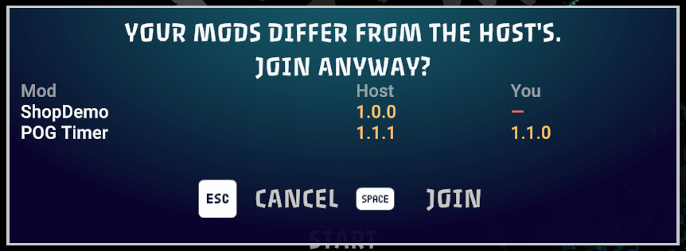
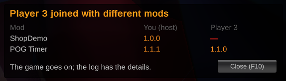

# POG Mod Check

Before you load into someone's Pit of Goblin game, your mods are compared with the host's. If they differ in a way
that matters, you see the game's own popup, still in the main menu, before anything loads:



**Esc** cancels and takes you back to the menu; **Space** joins anyway (on a keyboard; with a gamepad the game shows
its own buttons). A dash means that side does not have the mod; two versions mean both have it, not the same one.

After joining, the host sees who joined with what, in a window in the top-right corner. It does not stop the game;
**F10** or its button closes it:



The MelonLoader log on both sides gets the same differences, with the reason each one matters. Mods that only change
your own screen (graphics, fonts, brightness) are never shown.

**Mod authors:** if your mod talks to other players, one line in it tells POG Mod Check: see
[For mod developers](#for-mod-developers).

## Install

With a Thunderstore mod manager (Gale, r2modman), or put `POGModCheck.dll` into the game's `Mods` folder. Needs
MelonLoader. The host and the players all need POG Mod Check for the comparison; with only one side having it, the
game goes on as before and the log says the other side did not answer.

## Which mods count

Every mod is one of three kinds:

- **Required for everyone**: every player needs it, the same version. A mod is so when its author marks it so, or
  when you name it in the config.
- **Same version**: nobody has to have it, but two players who both have it need the same version. POG Timer is one:
  the host sends its timer to the others. A mod is so when its author marks it so, or when you name it in the config.
- **Own only**: everything else (graphics, fonts, brightness): what one player runs is nobody else's business, and it
  is never shown.

A mod that says nothing is own only. The log says which of your mods count and why.

## For mod developers

**Why.** POG Mod Check cannot tell by itself whether your mod matters to the other players, so a mod that says
nothing counts as "own only" and is never compared. If your mod sends anything to the other players, or needs them to
have it, say so with one line: players with a different copy then see it in the popup above before they load in,
instead of wondering later why something is broken.

**What to do.** Pick the line that fits your mod, paste it into any `.cs` file of your mod, outside a `namespace`
(next to your `[assembly: MelonInfo(...)]` is a good place), and rebuild. That is all.

| Your mod... | For example | Add |
|---|---|---|
| changes only what one player sees or does | graphics, fonts, a HUD | nothing |
| works for whoever has it, but two players who both have it need the same version | a timer the host sends to the others | `same-version` |
| must be on every player, or the game goes wrong for the one without it | rules both sides must agree on | `required` |

```csharp
// same-version: nobody has to have it; whoever has it needs the host's version
[assembly: System.Reflection.AssemblyMetadata("POGModCheck", "same-version")]

// required: every player needs it, the same version
[assembly: System.Reflection.AssemblyMetadata("POGModCheck", "required")]
```

A real one, from [POG Timer](https://github.com/largoz/POGTimer/blob/main/src/TimerMod.cs):

```csharp
[assembly: MelonInfo(typeof(POGMods.Timer.TimerMod), "POG Timer", POGMods.Timer.TimerMod.VERSION, "largo", "https://github.com/largoz/POGTimer")]
[assembly: MelonOptionalDependencies("POGConfig")]
// For POG Mod Check: nobody has to run POG Timer, but two players who both do should run the same version.
// A standard .NET attribute: no reference to POG Mod Check, nothing changes without it.
[assembly: System.Reflection.AssemblyMetadata("POGModCheck", "same-version")]
```

**Nothing else.**

- No reference to POG Mod Check and no dependency in your `manifest.json`: `AssemblyMetadata` is a standard .NET
  attribute. Players without POG Mod Check notice nothing.
- The version compared is the one in your `MelonInfo`. A rebuild without a version bump shows as "another build"
  (the start of each DLL's hash beside the version).

**Check it.** Start the game with POG Mod Check and find your mod in the MelonLoader console (or
`MelonLoader/Latest.log`):

```
[POG_Mod_Check] Whoever has them needs the same version: My Mod (its author marks it).
[POG_Mod_Check] Every player needs: My Mod (its author marks it).
```

The first line is for `same-version`, the second for `required`. A misspelled value shows a warning there and counts
as no line at all.

**Players can do it too**, for a mod whose author has not: the `Required` and `SameVersion` settings below.

(One exception needs no line: a mod that adds items or shop slots through the
[POGLib](https://github.com/largoz/POGLib) library is found by itself and counts as required.)

## Settings

`UserData/MelonPreferences.cfg`, section `[POGModCheck]`:

- `Required`: more mods every player must have, comma-separated, names as in the MelonLoader console;
- `SameVersion`: more mods that whoever has them must run in the same version, in the same form;
- `ShowWindow`: `false` keeps only the log;
- `AskBeforeJoin`: `false` turns the check before loading off. As the host, no joining player is stopped; as a
  player, you are never stopped. Either way the window after joining still reports the differences.

## How it works

**Before loading.** A joining player adds a short entry to the game's own connection data (the game keeps its
content keys there): for each of its mods, a fingerprint of its name, one of its copy (name, version and DLL hash),
and its kind; no names travel. A host with POG Mod Check compares it with its own mods when the game approves the
connection. If a mod differs where it matters, the host does not let the player in yet and gives, as the reason, its
own copies the player needs to compare (those that differ, and its copies of those the player requires). The player
handles that reason the way the game handles its own "missing dungeon content" retry: the join stays open, no "lost connection" popup,
and it asks. Join connects again saying it accepts; Cancel takes the game's ordinary way back to the menu. A host
without POG Mod Check ignores the entry (the game only looks for its own keys) and lets the player in as before.

**After joining.** The lists (name, version, the first 12 hex digits of the DLL's SHA-256, its kind) travel
over a Netcode named message, `POGModCheck/List`, not over the Steam lobby, so it works in any session the game's
networking runs. Both sides need the mod for the comparison. A side that hears nothing within 15 seconds says so in
the log: a player whose host has no POG Mod Check, or a host whose joining player has none (named by its player
number). The window shows it only when you run mods everyone needs; otherwise nothing of yours can be missing over
there. Several reports stack in the window, so a second player joining does not hide the first one's.

If a game update changes what the check before loading hooks into, the log says so and only the check after joining
runs.

## Building

`dotnet build -c Release` (the game's assemblies are found through `GameDir`, by default the Gale profile; pass
`-p:GameDir=<folder with MelonLoader>` otherwise). Unit tests: `dotnet test tests/ModCheck.Tests`.
